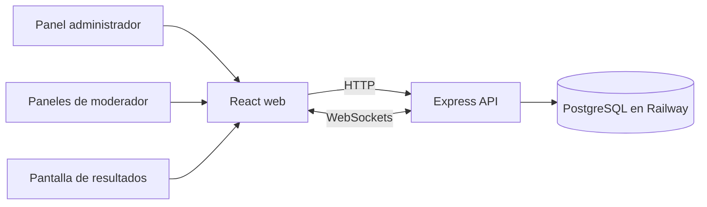

# RallyFML — Software Design Document

**Estado:** especificación funcional actualizada para la implementación inicial.
**Propósito:** digitalizar la operación de un rally por estaciones, la evaluación de equipos y la presentación de resultados.

## Alcance y usuarios

El sistema tendrá dos roles:

- **Administrador:** en el primer acceso configura sus credenciales; usa un asistente para definir tiempos globales, equipos, estaciones y actividades; inicia el juego, consulta la tabla en vivo y decide cuándo mostrar el podio.
- **Moderador:** varios moderadores pueden compartir el único dispositivo de su estación y su clave; eligen el equipo participante, ejecutan la dinámica y registran la evaluación desde un panel táctil con botones y mínima escritura.

El rally tendrá cinco equipos de forma predeterminada; el administrador podrá definir sus nombres y cantidad. Las estaciones representan dinámicas de tipo trivia, charadas, creatividad, dramatización o dinámica externa. Cada estación tendrá título, descripción, una clave única de moderación y un banco de preguntas o mandatos. La duración de participación y el cooldown se configuran una sola vez en el rally.

## Reglas de negocio y puntuación

- Cada respuesta correcta de trivia o charadas vale 1 punto; una incorrecta, 0. Trivia usa cuatro opciones y una respuesta correcta; el moderador toca la opción que eligió el equipo.
- Las preguntas de trivia y los ítems de charadas se presentan en orden aleatorio por participación. No se repiten dentro de la participación de un equipo; otros equipos pueden recibir los mismos ítems.
- Creatividad, dinámica externa y dramatización permiten un banco con varios mandatos, del que se sortea uno por equipo. En creatividad y dinámica externa, el moderador asigna de 0 a 5 puntos una vez; en dramatización asigna de 0 a 5 puntos por la escena elegida. Todos los puntajes son enteros.
- Cada equipo participa exactamente una vez en cada estación. El juego termina cuando se completan todas las combinaciones equipo-estación.
- El total de un equipo es la suma de sus puntuaciones. La tabla se actualiza en vivo; después de finalizar el juego, el administrador inicia la presentación del podio. El sistema señala los empates, pero no aplica desempate.
- El administrador fija en el rally la duración de actividad y el cooldown. Cada ronda es simultánea: cada moderador prepara un equipo distinto y el administrador inicia el reloj común cuando todas las estaciones están listas. No se puede configurar más estaciones que equipos.
- La administración permite elegir minutos y segundos por separado para la duración y el cooldown; la API y PostgreSQL reciben y almacenan el total como segundos enteros.
- El administrador puede terminar la ronda antes de tiempo o extenderla entre 1 y 300 segundos; ambas acciones se aplican a todas las estaciones activas. Al terminar, cada moderador debe cerrar manualmente su alarma; esta no desaparece sola. El cooldown empieza al cerrar el ciclo y bloquea el siguiente inicio hasta que venza.
- El administrador puede editar nombre, tiempos, equipos, estaciones y bancos de mandatos durante la configuración, entre rondas en vivo y después de finalizar. El servidor bloquea los cambios mientras haya participaciones activas. Al retirar equipos, estaciones o mandatos, se archivan para conservar puntajes y respuestas históricas; si se edita un rally finalizado, el podio debe presentarse de nuevo.
- Durante los últimos diez segundos suena un pulso de cuenta regresiva; al finalizar se reproduce una alarma repetida con otro tono.
- Si el administrador finaliza el rally antes de completar todas las combinaciones equipo-estación, puede retomarlo. Se conservan puntajes y participaciones completadas, se oculta de nuevo el podio y solo quedan pendientes las combinaciones sin completar. Un rally con todas las estaciones completas no se puede reabrir.

## Experiencia principal

1. En el primer acceso, el administrador configura sus credenciales; después recorre los pasos de tiempos globales, equipos, estaciones y revisión. En cada estación define actividades, mandatos y una clave de moderación.
2. El administrador inicia el rally; esto abre la preparación, pero no pone en marcha el reloj.
3. Cada moderador selecciona un equipo disponible para su estación. Cuando todas las estaciones tienen un equipo distinto y están fuera del cooldown, el administrador inicia la ronda simultánea.
4. El servidor comparte el mismo vencimiento para todas las estaciones. El administrador puede terminar o extender el tiempo global; cuando termina, cada estación muestra su alarma hasta que el moderador la cierre.
5. Durante el cooldown global los moderadores pueden seleccionar equipos para la siguiente ronda. El administrador vuelve a iniciar el reloj cuando todas las estaciones están listas. Cuando todos los equipos completan todas las estaciones, el juego termina y el administrador puede revelar el podio animado.

La interfaz de moderación será _touch-first_: controles grandes, selección visual de equipos, opciones de trivia fáciles de tocar, estados claros de tiempo y actividad, y sin depender de escribir durante el juego. Las animaciones de resultados usarán [Motion for React](https://motion.dev/docs/react), respetando la preferencia de movimiento reducido del dispositivo.

## Arquitectura propuesta

Monorepo gestionado con Turborepo y TypeScript:

- `apps/web`: React, Tailwind CSS y Motion for React; panel de administración, paneles de estación y pantalla de resultados.
- `apps/api`: Node.js con Express; API para configuración, autorización y registro de participaciones y puntuaciones.
- `packages/shared`: contratos, validaciones de datos y reglas compartidas entre cliente y servidor.
- **Tiempo real:** Socket.IO sobre WebSockets para propagar inicio, estado de estaciones, temporizadores y resultados.
- **Persistencia:** PostgreSQL gestionado en Railway para equipos, estaciones, actividades, credenciales y puntuaciones.
- **Despliegue:** Docker Compose para desarrollo local. Railway no ejecuta un archivo Compose directamente, aunque puede importar sus servicios con algunas limitaciones; en producción cada servicio se configura como un servicio Railway. Ver [guía de Compose de Railway](https://docs.railway.com/guides/docker-compose) y [PostgreSQL en Railway](https://docs.railway.com/databases/postgresql).

## Modelo de datos inicial

`Game` mantiene el estado, duración común y cooldown; `Team` guarda los equipos; `Station` contiene título, descripción, tipo y clave de acceso; `Prompt` contiene preguntas o mandatos y, para trivia, cuatro opciones y la respuesta correcta; `Participation` registra el único ciclo por equipo y estación junto con su orden aleatorio de mandatos y puntaje final. La clave compartida solo permite operar su estación. Una restricción única sobre equipo y estación evita registrar una segunda participación.

## Seguridad y confiabilidad

- Validar en tiempo de ejecución las entradas de API y WebSocket; los tipos de TypeScript no validan datos recibidos.
- Autorizar cada operación en el servidor: administración solo para el administrador y puntuación solo para la estación asociada a la clave del moderador.
- Guardar las credenciales del administrador y las claves de estación como hashes; limitar intentos y no incluir claves, tokens ni datos personales en logs.
- Permitir el alta inicial del administrador solo cuando aún no exista uno, protegida con un secreto de aprovisionamiento de un solo uso configurado en Railway; deshabilitar el alta después.
- No guardar una puntuación antes de validar equipo, estación, actividad y rango de puntos permitido.
- Mantener la pantalla pública de resultados en modo de solo lectura.
- El servidor será la fuente de verdad para el temporizador y el cooldown; los clientes mostrarán la cuenta regresiva y recuperarán el estado al reconectarse.

## Decisiones técnicas acordadas

- PostgreSQL gestionado por Railway será la base de datos y Socket.IO llevará las actualizaciones en tiempo real.
- Docker Compose se usará para desarrollo local. Railway no ejecuta Compose directamente; en producción, cada servicio se configurará por separado en Railway.
- El alta inicial del administrador estará protegida por un secreto de aprovisionamiento de un solo uso configurado como variable secreta en Railway. Se deshabilitará después de crear las credenciales del administrador.
